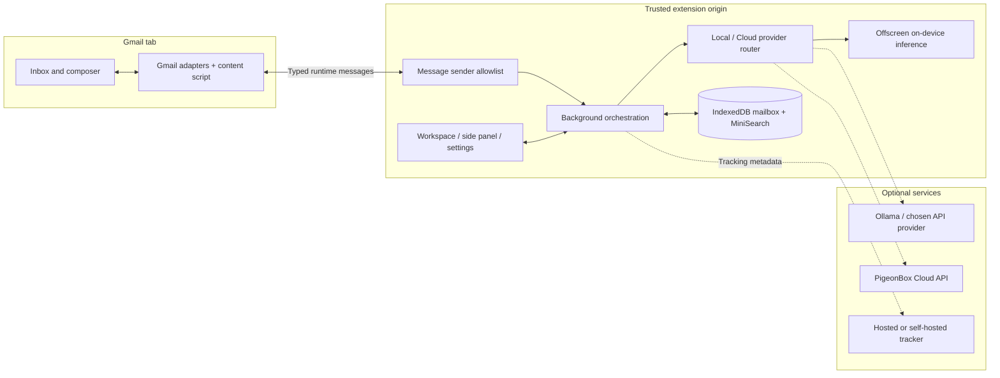

# PigeonBox

**Sort Gmail, understand a thread, and prepare a reply from a workspace inside your inbox.**

PigeonBox is a Manifest V3 Chrome extension with a local mailbox index, on-device AI options, and optional hosted services. Start without a PigeonBox account; choose where AI runs and whether to enable tracking.

[Install](#install) · [How it works](#architecture) · [Documentation](docs/README.md) · [Changelog](CHANGELOG.md)

[](https://github.com/aiden-guan/pigeonbox/actions/workflows/ci.yml)
[](https://github.com/aiden-guan/pigeonbox/releases)
[](LICENSE)


*All captures below render the compiled extension in a disposable Chromium profile with synthetic mail. Cloud responses and prepared text are fixtures; these images demonstrate the interface, not live Gmail, model quality, or a deployed backend. [Capture provenance and reproduction](assets/readme/README.md).*

## From inbox to next action

Gmail tells you what arrived. PigeonBox adds a working view of what needs a reply, what is waiting on someone else, and what can be read later. Open a brief, inspect its source thread, and prepare your response without moving to another mail client.

| Triage the inbox | Read the thread brief |
| :--- | :--- |
|  |  |
| Respond, Waiting, FYI, and Follow-ups organize locally indexed threads. Rules work with AI disabled; local importance ranking can learn from your choices. | A thread brief brings the summary, action items, dates, and source email into the workspace. Full text becomes available as threads are opened or ingested. |

| Review a prepared reply · Cloud fixture | Ask with sources · Cloud fixture |
| :--- | :--- |
|  |  |
| Inspect a prepared variant before placing it in Gmail. Local drafting uses the selected AI provider; hosted prepared drafts require Cloud access and permissions. | Chat shows source references and coverage information. Local mode searches the browser's index; Cloud uses the connected service. An incomplete index cannot establish that mail does not exist. |

Also included: keyboard triage, reusable snippets, reminders, open/click activity, and a Track PDF composer action for hosted document links. Availability depends on settings, build configuration, and account capabilities.

### Try one complete workflow

1. Load the extension, open Gmail, and choose **On this computer** during onboarding. AI can stay disabled.
2. Open a few threads so the local index has message text, then inspect **Mail → Respond**.
3. Open a thread's brief. With AI configured, request a summary or draft; inspect the text in Gmail's composer before sending.
4. Open **Chat** and search the indexed mail. Check the cited thread and the coverage notice alongside the answer.
5. If tracking is enabled, inspect **Waiting** for observed activity. An open signal is evidence of an image request, not proof that someone read the email.

## Choose where work runs

Free/Pro describe product access; Local/Cloud describe execution. They are separate choices: signed-in Free accounts can use hosted tracking without moving local AI to Cloud.

| | On this computer | PigeonBox Cloud |
| :--- | :--- | :--- |
| **Account** | No PigeonBox account for local inbox and AI | Sign-in, explicit consent, and server-granted capabilities |
| **AI** | WebGPU models, Chrome built-in AI where available, Ollama, or your API endpoint/key | Configured hosted provider through the Cloud API |
| **Mail context** | IndexedDB and local lexical search, populated as mail is ingested | Client support for Google-connected thread intelligence, drafts, tasks, and briefings |
| **When Gmail closes** | No continuous server mailbox sync | Connected service can process mail in the background; requires its own backend and Google authorization |
| **Failure behavior** | Local capabilities do not depend on a Cloud session | Provider errors are surfaced; the router does not silently select another provider |
| **Source in this repo** | Extension, agent, provider adapters, local storage/search, self-hostable trackers | Client, protocol schemas, UI, and synthetic API fixtures; the hosted application is maintained separately |

**Local mode does not mean every setting is offline.** A remote BYOK endpoint receives the context needed for that request. Model downloads, Gmail itself, tracking, release checks, and optional services need connectivity. Cached local data and supported on-device inference can operate without a hosted AI backend.

Anonymous usage events are on by default and can be disabled in **Settings → Privacy & data**. They use an allowlisted event format with a random install ID; they are separate from email tracking. See [product analytics](docs/product-analytics.md).

## Install

### Build from source

Use the Node.js version in [.nvmrc](.nvmrc), npm, Git, and Chrome 116+ (or a compatible Chromium browser). With nvm installed, run `nvm install` and `nvm use` after cloning.

```bash
git clone https://github.com/aiden-guan/pigeonbox.git
cd pigeonbox
npm run setup -- --open
```

The setup helper installs missing dependencies, generates ignored local tracker configuration, builds the workspaces, and opens Chrome's extensions page. Local inbox features need no AI key or backend account.

1. Open `chrome://extensions` and enable **Developer mode**.
2. Select **Load unpacked → apps/extension/dist**.
3. Open or reload Gmail and start onboarding from the PigeonBox toolbar icon.

For an AI-assisted install, give your coding agent the instructions in [INSTALL.md](INSTALL.md). See [local setup](docs/local-setup.md) for manual dependency installation, provider setup, and troubleshooting; `npm run dev` watches the extension.

### Download a release

Unzip `PigeonBox-vX.Y.Z.zip` from [GitHub Releases](https://github.com/aiden-guan/pigeonbox/releases/latest) and load the extracted directory. Node.js is unnecessary for a prebuilt ZIP. A tagged release can lag behind the source branch, and a GitHub release is separate from Chrome Web Store publication.

Unpacked extensions need a new download/build and a reload in `chrome://extensions` to update. Store-managed installs use Chrome's update mechanism; see the [release process](docs/release-process.md).

### Enable tracking separately

Tracking is optional. A recipient's device needs a public HTTPS endpoint; a localhost tracker is only useful for development.

| Path | What it requires |
| :--- | :--- |
| **Hosted tracking** | A build with hosted endpoints, a signed-in PigeonBox account, and tracking enabled. Free supports opens/clicks; hosted document features depend on capabilities. |
| **Your Convex tracker** | Run `npm run setup:tracker -- --open`. The helper requests approval before creating or updating resources in your provider account. [Guide](docs/convex-self-hosting.md). |
| **Your Cloudflare Worker + Supabase** | Deploy the HTTP tracker and its durable database, then save the endpoint/token in Settings. [Guide](docs/self-hosting.md). |
| **Development tracker** | `npm run tracker`; in-memory storage resets when the process stops. |

**Track PDF** uploads a document for a hosted viewer link. Ordinary Gmail paperclip attachments do not emit PigeonBox document events. Image proxies, blocked images, scanners, and sender views make all tracking signals imperfect. See [tracking](docs/tracking.md) and [tracking diagnostics](docs/tracking-debug.md).

## Architecture

The Gmail content script handles page integration. The extension service worker owns settings, credentials, provider selection, and persistence; an offscreen document hosts on-device model work.



1. [Gmail adapters](packages/gmail/src/index.ts) observe thread/row lifecycles and normalize the mail available in the page.
2. The content script sends ingestion and action requests through the [message allowlist](apps/extension/src/background/messaging.ts). Settings mutations and other privileged messages require an extension page.
3. The [mailbox database](packages/mailbox/src/db.ts) persists indexed mail. [MiniSearch](packages/search/src/index.ts) indexes subject, text, participants, and labels; its coverage notice describes the available local corpus.
4. The [provider router](apps/extension/src/background/ai/provider-router.ts) selects the configured execution path. [Core capabilities](packages/core/src/index.ts) keep Local availability independent of Cloud state; [API contracts](packages/api-contract/src/index.ts) define hosted requests and responses.
5. The [workspace](apps/extension/src/workspace/PigeonBoxWorkspace.tsx) renders results. Gmail integration places prepared text in the composer; tracking receipts and sender-view signals use their own retry paths.

Detailed modules and message flows: [architecture](docs/architecture.md). Hosted request shapes: [Cloud protocol](docs/cloud-protocol.md).

## Engineering decisions

### Tracking a sender's view without calling it a recipient open

- **Problem:** Opening your own Sent thread can make Gmail's image proxy fetch the same pixel a recipient would load. Timing alone cannot reliably identify the reader.
- **Approach:** [Tracking lifecycle helpers](packages/tracking/src/lifecycle.ts) model sender fingerprints, expiring self-view claims, one-shot proxy consumption, duplicate bursts, and evidence classification. The [Worker tracker](workers/tracker/src/index.ts) applies those rules to persisted events; the extension retries sender claims and send receipts.
- **Why:** Explicit event identity and bounded claims let retries repair state without treating each request as a new recipient interaction.
- **Tradeoff:** Proxy requests remain ambiguous. Suppression can miss or absorb activity, so the UI reports observations and confidence rather than proof of reading. [Reliability boundaries](docs/tracking-reliability.md).

### Credentials across several browser contexts

- **Problem:** Gmail's page, content scripts, extension pages, and the service worker need different privileges, even when they participate in the same workflow.
- **Approach:** [Messaging](apps/extension/src/background/messaging.ts) checks the sender and message type, restricts extension storage to `TRUSTED_CONTEXTS`, and gives content scripts a public settings projection. [Credential handling](apps/extension/src/background/settings-credentials.ts) clears saved credentials when their destination changes.
- **Why:** The Gmail integration can request specific work without receiving the API keys or tracker tokens that perform it.
- **Tradeoff:** UI state crosses asynchronous messages, and each new message needs a deliberate permission boundary. This does not make untrusted email safe by itself. [Threat model](docs/threat-model.md).

### Provider failures preserve the selected boundary

- **Problem:** Falling back to another model provider during an outage would change where mail content goes.
- **Approach:** The [router](apps/extension/src/background/ai/provider-router.ts) returns an explicit Cloud error; [capability resolution](packages/core/src/index.ts) derives Local features from device settings rather than a hosted entitlement response.
- **Why:** Provider selection remains a user decision, including when a service fails.
- **Tradeoff:** A Cloud-dependent request can remain unavailable until connectivity returns or the user changes mode. [Router tests](apps/extension/src/background/ai/provider-router.test.ts).

## Codebase map

| Responsibility | Source and tools |
| :--- | :--- |
| **Gmail workspace** | [apps/extension](apps/extension) — React, Vite, Manifest V3; content scripts, trusted UI, background worker, offscreen runtime |
| **Mail integration** | [packages/gmail](packages/gmail) — InboxSDK and DOM integration, lifecycle handling, compose actions |
| **Intelligence** | [packages/agent](packages/agent), [packages/ai](packages/ai) — rules, job queue, prompts, provider adapters; Transformers.js for on-device models |
| **Data and retrieval** | [packages/mailbox](packages/mailbox), [packages/search](packages/search) — Dexie/IndexedDB, local importance ranking, MiniSearch lexical retrieval |
| **Mode and protocol** | [packages/core](packages/core), [packages/api-contract](packages/api-contract), [packages/cloud-client](packages/cloud-client) — capabilities, Zod schemas, authenticated client |
| **Tracking** | [packages/tracking](packages/tracking), [workers/tracker](workers/tracker), [convex](convex) — shared event protocol and self-hostable backends |
| **Shared settings** | [packages/shared](packages/shared) — types, owner identity, settings defaults and migrations |
| **Verification and delivery** | [scripts](scripts), [tests/browser](tests/browser), [.github/workflows](.github/workflows) — hygiene, release validation, Vitest, Playwright, CI |

### Configuration

- [.env.example](.env.example) describes optional self-hosted tracker settings. The Supabase service-role credential belongs only on the backend.
- [apps/extension/.env.example](apps/extension/.env.example) documents public build-time origins and the optional unpacked extension public key. Anything compiled into the extension must be public.
- Enter AI endpoint/key and tracker settings through the extension settings UI. Local secret files, generated tracker configuration, model/build outputs, and test reports are ignored by Git.
- The hosted backend's deployment secrets and database are outside this repository. Building the client does not provision that service.

## Verify a checkout

```bash
# Repository checks, versions, typecheck, lint, unit/script tests,
# workspace build, and an isolated release build + ZIP validation
npm run verify

# Install the browser once, then run extension integration fixtures
npx playwright install chromium
npm run test:browser
```

`verify` needs no Cloud backend, AI key, or deployed tracker. It does **not** run Playwright. Browser fixtures exercise the compiled extension in disposable profiles with a synthetic Gmail page and API responses; they do not establish live provider acceptance or current Gmail compatibility.

CI runs those checks plus browser tests against a packaged release. The badge links to remote CI; a local pass alone does not establish deployed behavior or store publication. See [manual verification](docs/VERIFICATION.md), [capture instructions](assets/readme/README.md), and [release process](docs/release-process.md).

## Status and limits

This repository contains the working extension and optional self-hosted trackers. Hosted UI and typed contracts are included; the Cloud service is a separate dependency. Feature availability comes from build configuration, settings, and server capabilities.

- **Gmail changes:** SDK and DOM integration need maintenance when Gmail changes its interface. Local mode uses the web page rather than requesting Gmail API scopes.
- **Wide inbox layout:** At widths of 600 CSS pixels or more, an older inbox grid rule can compress the current list and brief into a narrow column. The feature captures use a 480-pixel panel; the wide Home capture uses a different view.
- **Coverage:** Local search covers ingested mail. Snippets, partial threads, and full threads carry different evidence; an answer cannot safely imply full-mailbox coverage.
- **Models:** On-device availability depends on browser APIs, model downloads, memory, and hardware. Generated summaries and replies need review.
- **Actions:** Generated text can be placed in Gmail for review. Scheduled sends, enabled rules, and Cloud approval flows have their own authorization paths; this project does not claim that every action is manual.
- **Privacy:** Remote AI, hosted tracking, and PDF uploads send the data needed by those services. Tracking includes subjects, addresses, IDs, and events, rather than message bodies. See [privacy model](docs/privacy-model.md).
- **Acceptance:** Live Gmail, Google OAuth, hosted AI, recipient tracking, and Chrome Web Store status require separate checks. The screenshots and fixture tests do not verify them.

For current work, use [issues](https://github.com/aiden-guan/pigeonbox/issues) and the [Unreleased changelog](CHANGELOG.md#unreleased). Historical investigations are kept in [docs/archive](docs/archive/README.md).

## Contribute

See [CONTRIBUTING.md](CONTRIBUTING.md) for development conventions and verification requirements. Report vulnerabilities through [SECURITY.md](SECURITY.md).

## License

[MIT](LICENSE).
