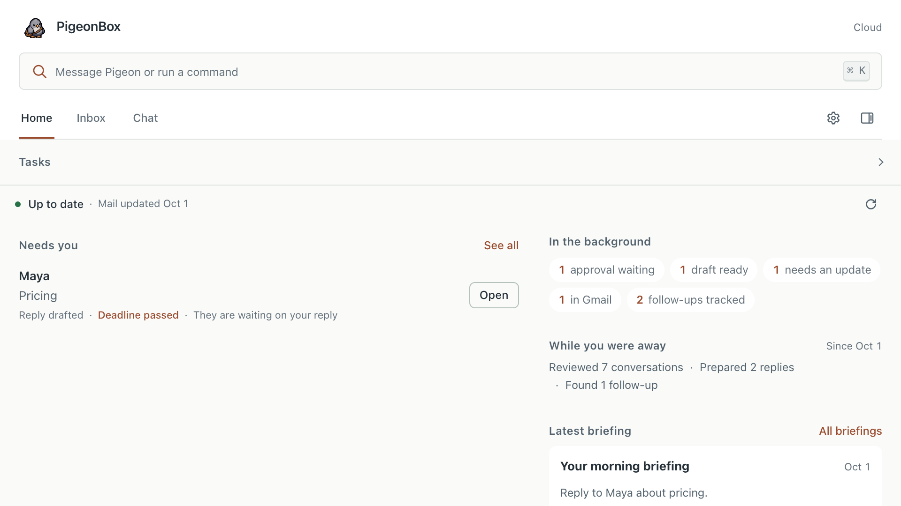
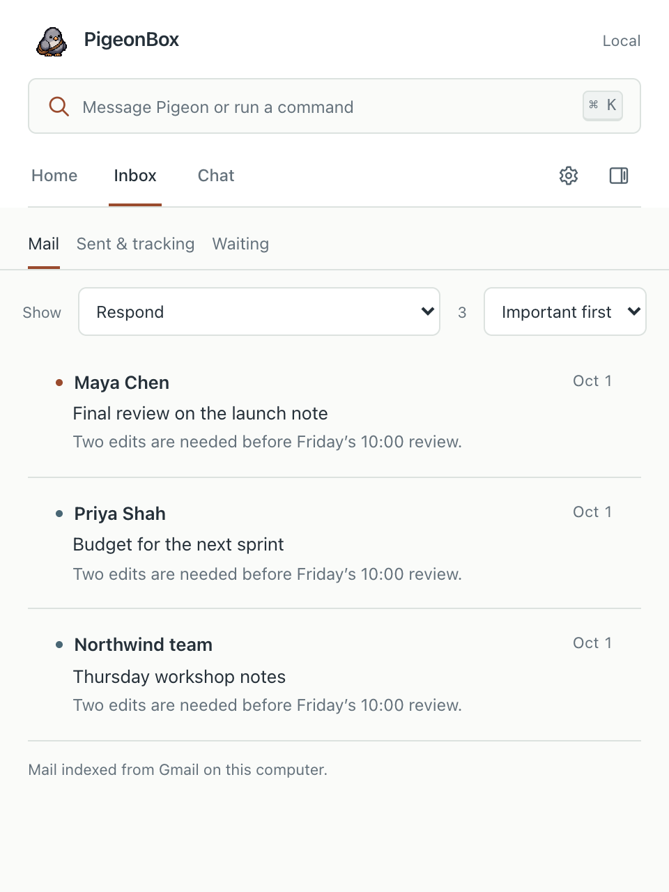
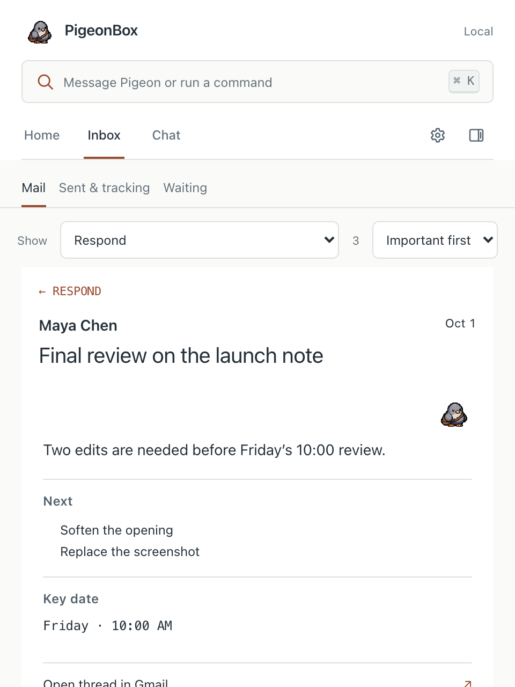
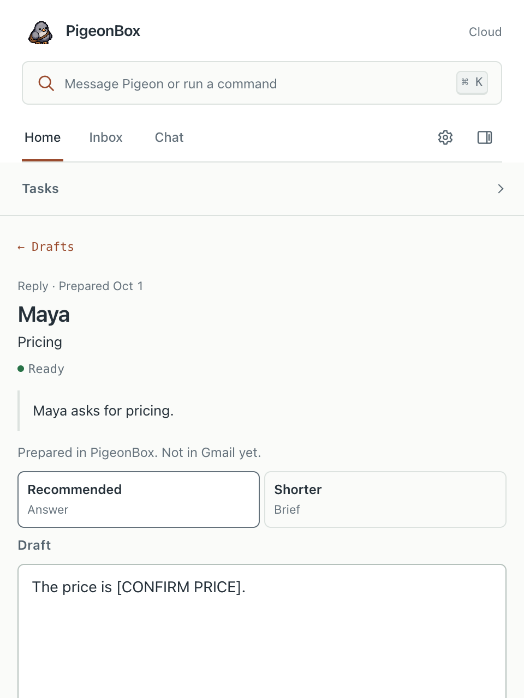
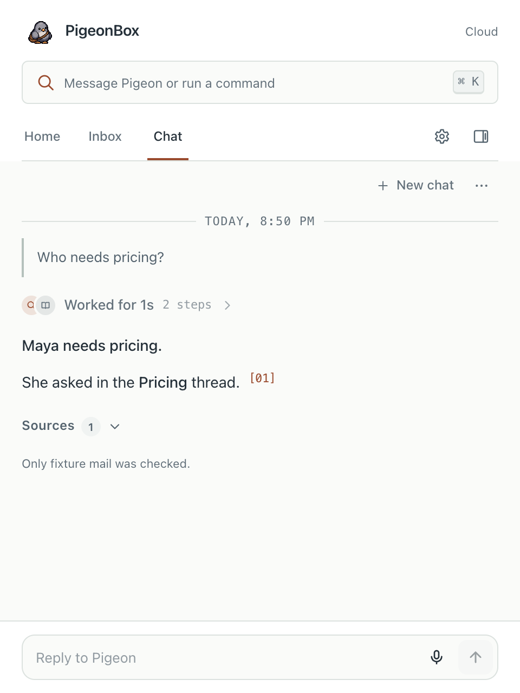
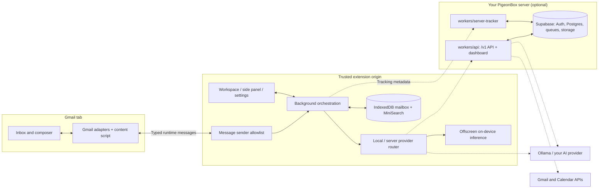

# PigeonBox

**Sort Gmail, understand a thread, and prepare a reply from a workspace inside your inbox. Free and open source, and it runs on your computer or on a server you own.**

PigeonBox is a Manifest V3 Chrome extension with a local mailbox index and on-device AI options. Add your own server when you want always-on features. There is no PigeonBox account, subscription or hosted service: you choose where AI runs, where mail data is stored and whether to track mail.

[Install](#install) · [Self-hosting](docs/self-hosting.md) · [How it works](#architecture) · [Documentation](docs/README.md) · [Changelog](CHANGELOG.md)

[](https://github.com/aiden-guan/pigeonbox/actions/workflows/ci.yml)
[](https://github.com/aiden-guan/pigeonbox/releases)
[](LICENSE)



*All captures below render the compiled extension in a disposable Chromium profile with synthetic mail. Server responses and prepared text are fixtures; these images demonstrate the interface, not live Gmail, model quality, or a deployed server. [Capture provenance and reproduction](assets/readme/README.md).*

## From inbox to next action

Gmail tells you what arrived. PigeonBox adds a working view of what needs a reply, what is waiting on someone else, and what can be read later. Open a brief, inspect its source thread, and prepare your response without moving to another mail client.

| Triage the inbox | Read the thread brief |
| :--- | :--- |
|  |  |
| Respond, Waiting, FYI, and Follow-ups organize locally indexed threads. Rules work with AI disabled; local importance ranking can learn from your choices. | A thread brief brings the summary, action items, dates, and source email into the workspace. Full text becomes available as threads are opened or ingested. |

| Review a prepared reply · server fixture | Ask with sources · server fixture |
| :--- | :--- |
|  |  |
| Inspect a prepared variant before placing it in Gmail. Local drafting uses the AI provider you pick; drafts prepared in the background come from your server. | Chat shows source references and coverage information. Local mode searches the browser's index; server mode searches the mail your server has synced. An incomplete index cannot establish that mail does not exist. |

Also included: keyboard triage, reusable snippets, reminders, open/click activity, and a Track PDF composer action for tracked document links. What's available depends on your settings and on what your server is configured for.

### Try one complete workflow

1. Load the extension, open Gmail, and choose **On this computer** during onboarding. AI can stay disabled.
2. Open a few threads so the local index has message text, then inspect **Mail → Respond**.
3. Open a thread's brief. With AI configured, request a summary or draft; inspect the text in Gmail's composer before sending.
4. Open **Chat** and search the indexed mail. Check the cited thread and the coverage notice alongside the answer.
5. If tracking is set up, inspect **Waiting** for observed activity. An open signal is evidence of an image request, not proof that someone read the email.

## Choose where work runs

| | On this computer | Your PigeonBox server |
| :--- | :--- | :--- |
| **Setup** | `npm run setup`; no accounts | `npm run server:deploy` on your own Cloudflare and Supabase accounts ([guide](docs/self-hosting.md)) |
| **Sign-in** | None | Google sign-in through your Supabase project; only addresses on your `ALLOWED_EMAILS` list |
| **AI** | WebGPU models, Chrome built-in AI where available, Ollama, or your API endpoint/key | The OpenAI-compatible endpoint and key your server is configured with |
| **Mail context** | IndexedDB and local lexical search, populated as mail is ingested | Your server syncs Gmail through the Gmail API (optional) for thread intelligence, prepared drafts, tasks and briefings |
| **When Gmail closes** | Nothing runs | Your server keeps processing mail in the background, if you set up the always-on Gmail layer |
| **Failure behavior** | Local features never depend on a server | Server errors are shown; PigeonBox never silently switches to another AI provider |

**Local mode does not mean every setting is offline.** A remote AI endpoint receives the context needed for that request. Model downloads, Gmail itself, tracking and update checks need connectivity. Cached local data and on-device inference work without any server.

PigeonBox sends no usage analytics. The only services it talks to are the ones you configure. See [privacy](PRIVACY.md).

## Install

### Build from source

Use the Node.js version in [.nvmrc](.nvmrc), npm, Git, and Chrome 116+ (or a compatible Chromium browser). With nvm installed, run `nvm install` and `nvm use` after cloning.

```bash
git clone https://github.com/aiden-guan/pigeonbox.git
cd pigeonbox
npm run setup -- --open
```

The setup helper installs dependencies, generates ignored local tracker configuration, builds the workspaces, and opens Chrome's extensions page. Local inbox features need no AI key and no account.

1. Open `chrome://extensions` and enable **Developer mode**.
2. Select **Load unpacked → apps/extension/dist**.
3. Open or reload Gmail and start onboarding from the PigeonBox toolbar icon.

For an AI-assisted install, give your coding agent the instructions in [INSTALL.md](INSTALL.md). See [local setup](docs/local-setup.md) for manual dependency installation, provider setup, and troubleshooting; `npm run dev` watches the extension.

### Add your own server

```bash
cp server.env.example server.env   # fill in Supabase, AI and Google values
npm run server:deploy
```

The deploy script migrates your Supabase database, deploys the API and tracker Workers to your Cloudflare account, points your extension build at them, and checks the result. The [self-hosting guide](docs/self-hosting.md) walks through every account and value, including the optional always-on Gmail layer.

### Download a release

Unzip `PigeonBox-vX.Y.Z.zip` from [GitHub Releases](https://github.com/aiden-guan/pigeonbox/releases/latest) and load the extracted directory. Node.js is unnecessary for a prebuilt ZIP. Release builds don't include a server address; to use your server, build from source and the deploy script points the build at it. A tagged release can lag behind the source branch.

Unpacked extensions need a new download/build and a reload in `chrome://extensions` to update. See the [release process](docs/release-process.md).

### Tracking

Tracking is optional. A recipient's mail client must reach a public HTTPS endpoint; a localhost tracker is only useful for development.

| Path | What it requires |
| :--- | :--- |
| **Your PigeonBox server** | Included with `npm run server:deploy`. Tracked PDFs also need `DOCUMENTS_BUCKET`. |
| **Your Convex tracker** | `npm run setup:tracker -- --open`. The helper asks before creating resources in your Convex account. [Guide](docs/convex-self-hosting.md). |
| **Your Cloudflare Worker + Supabase tracker** | A single-user tracker with a personal token. [Guide](docs/tracker-cloudflare.md). |
| **Development tracker** | `npm run tracker`; in-memory storage resets when the process stops. |

**Track PDF** uploads a document to your server for a tracked viewer link. Ordinary Gmail paperclip attachments do not emit PigeonBox document events. Image proxies, blocked images, scanners, and sender views make all tracking signals imperfect. See [tracking](docs/tracking.md) and [tracking diagnostics](docs/tracking-debug.md).

## Architecture

The Gmail content script handles page integration. The extension service worker owns settings, credentials, provider selection, and persistence; an offscreen document hosts on-device model work. The optional server is two Cloudflare Workers over a Supabase project.



1. [Gmail adapters](packages/gmail/src/index.ts) observe thread/row lifecycles and normalize the mail available in the page.
2. The content script sends ingestion and action requests through the [message allowlist](apps/extension/src/background/messaging.ts). Settings mutations and other privileged messages require an extension page.
3. The [mailbox database](packages/mailbox/src/db.ts) persists indexed mail. [MiniSearch](packages/search/src/index.ts) indexes subject, text, participants, and labels; its coverage notice describes the available local corpus.
4. The [provider router](apps/extension/src/background/ai/provider-router.ts) selects the configured execution path. [Core capabilities](packages/core/src/index.ts) keep Local availability independent of server state; the [API contract](packages/api-contract/src/index.ts) defines every server request and response.
5. The [server](packages/server/src/api.ts) authenticates each request, checks the [access list](packages/server/src/auth.ts) and the capabilities the server is configured for, runs AI and the always-on Gmail layer, and validates every response against the contract.
6. The [workspace](apps/extension/src/workspace/PigeonBoxWorkspace.tsx) renders results. Gmail integration places prepared text in the composer; tracking receipts and sender-view signals use their own retry paths.

Detailed modules and message flows: [architecture](docs/architecture.md), [server architecture](docs/server/architecture.md). Request shapes: [server protocol](docs/cloud-protocol.md).

## Engineering decisions

### Tracking a sender's view without calling it a recipient open

- **Problem:** Opening your own Sent thread can make Gmail's image proxy fetch the same pixel a recipient would load. Timing alone cannot reliably identify the reader.
- **Approach:** [Tracking lifecycle helpers](packages/tracking/src/lifecycle.ts) model sender fingerprints, expiring self-view claims, one-shot proxy consumption, duplicate bursts, and evidence classification. The [tracker](workers/tracker/src/index.ts) applies those rules to persisted events; the extension retries sender claims and send receipts.
- **Why:** Explicit event identity and bounded claims let retries repair state without treating each request as a new recipient interaction.
- **Tradeoff:** Proxy requests remain ambiguous. Suppression can miss or absorb activity, so the UI reports observations and confidence rather than proof of reading. [Reliability boundaries](docs/tracking-reliability.md).

### Credentials across several browser contexts

- **Problem:** Gmail's page, content scripts, extension pages, and the service worker need different privileges, even when they participate in the same workflow.
- **Approach:** [Messaging](apps/extension/src/background/messaging.ts) checks the sender and message type, restricts extension storage to `TRUSTED_CONTEXTS`, and gives content scripts a public settings projection. [Credential handling](apps/extension/src/background/settings-credentials.ts) clears saved credentials when their destination changes.
- **Why:** The Gmail integration can request specific work without receiving the API keys or tracker tokens that perform it.
- **Tradeoff:** UI state crosses asynchronous messages, and each new message needs a deliberate permission boundary. This does not make untrusted email safe by itself. [Threat model](docs/threat-model.md).

### Provider failures preserve the selected boundary

- **Problem:** Falling back to another model provider during an outage would change where mail content goes.
- **Approach:** The [router](apps/extension/src/background/ai/provider-router.ts) returns an explicit server error; [capability resolution](packages/core/src/index.ts) derives Local features from device settings rather than a server response.
- **Why:** Provider selection remains your decision, including when a service fails.
- **Tradeoff:** A server-dependent request can remain unavailable until connectivity returns or you change mode. [Router tests](apps/extension/src/background/ai/provider-router.test.ts).

### A server that only offers what it can serve

- **Problem:** A self-hosted server may be configured for AI and tracking but not for Gmail sync or tracked PDFs. Advertising a feature it can't run would fail later, in the middle of a task.
- **Approach:** [`servedCapabilities`](packages/server/src/config.ts) derives the feature list from the server's configuration, and [entitlements](packages/server/src/entitlements.ts) grant exactly that list to accounts on `ALLOWED_EMAILS`. A half-configured feature stops the Worker at startup with a clear error.
- **Why:** The extension and dashboard show only what works, and a misconfiguration is found at deploy time.
- **Tradeoff:** Turning on a feature means a redeploy with its settings, not a toggle in the UI.

## Codebase map

| Responsibility | Source and tools |
| :--- | :--- |
| **Gmail workspace** | [apps/extension](apps/extension) — React, Vite, Manifest V3; content scripts, trusted UI, background worker, offscreen runtime |
| **Mail integration** | [packages/gmail](packages/gmail) — InboxSDK and DOM integration, lifecycle handling, compose actions |
| **Intelligence** | [packages/agent](packages/agent), [packages/ai](packages/ai) — rules, job queue, prompts, provider adapters; Transformers.js for on-device models |
| **Data and retrieval** | [packages/mailbox](packages/mailbox), [packages/search](packages/search) — Dexie/IndexedDB, local importance ranking, MiniSearch lexical retrieval |
| **Mode and protocol** | [packages/core](packages/core), [packages/api-contract](packages/api-contract), [packages/cloud-client](packages/cloud-client) — capabilities, Zod schemas, authenticated client |
| **Server** | [packages/server](packages/server), [workers/api](workers/api), [workers/server-tracker](workers/server-tracker), [apps/web](apps/web), [supabase](supabase) — API, always-on Gmail layer, dashboard, schema; Cloudflare Workers + Supabase |
| **Tracking** | [packages/tracking](packages/tracking), [workers/tracker](workers/tracker), [convex](convex) — shared event protocol and the standalone trackers |
| **Shared settings** | [packages/shared](packages/shared) — types, owner identity, settings defaults and migrations |
| **Verification and delivery** | [scripts](scripts), [tests/browser](tests/browser), [tests/server](tests/server), [.github/workflows](.github/workflows) — hygiene, deploy, release validation, Vitest, Playwright, CI |

### Configuration

- [server.env.example](server.env.example) lists every server setting. `npm run server:deploy` reads your copy, `server.env`, and keeps generated keys in `.local/server-secrets.json`. Both are gitignored.
- [apps/extension/.env.example](apps/extension/.env.example) documents build-time settings, including your server's address (written for you by the deploy script). Anything compiled into the extension must be public.
- [.env.example](.env.example) configures the standalone single-user tracker.
- Enter AI endpoint/key and tracker settings through the extension settings UI. Local secret files, generated configuration, model/build outputs, and test reports are ignored by Git.

## Verify a checkout

```bash
# Repository checks, versions, typecheck, lint, unit tests (extension and
# server, with an in-process WASM Postgres), workspace build, and an isolated
# release build + ZIP validation
npm run verify

# Install the browser once, then run the browser fixtures
npx playwright install chromium
npm run test:browser          # the extension
npm run test:server-browser   # the server dashboard
```

`verify` needs no deployed server, AI key, or tracker. Browser fixtures exercise the compiled extension and dashboard with a synthetic Gmail page and API responses; they do not establish live provider acceptance or current Gmail compatibility. Against a deployed server, `npm run server:smoke` runs read-only checks.

See [manual verification](docs/VERIFICATION.md), [capture instructions](assets/readme/README.md), and [release process](docs/release-process.md).

## Status and limits

- **Gmail changes:** SDK and DOM integration need maintenance when Gmail changes its interface. Local mode uses the web page rather than requesting Gmail API scopes.
- **Google verification:** the always-on Gmail layer uses restricted Gmail scopes. A personal server works with an unverified Google app (with Google's warning and a 100-user cap); offering it to the public needs Google's verification. See [self-hosting](docs/self-hosting.md#always-on-gmail).
- **Wide inbox layout:** At widths of 600 CSS pixels or more, an older inbox grid rule can compress the current list and brief into a narrow column. The feature captures use a 480-pixel panel; the wide Home capture uses a different view.
- **Coverage:** Local search covers ingested mail. Snippets, partial threads, and full threads carry different evidence; an answer cannot safely imply full-mailbox coverage.
- **Models:** On-device availability depends on browser APIs, model downloads, memory, and hardware. Generated summaries and replies need review.
- **Actions:** Generated text can be placed in Gmail for review. Scheduled sends, enabled rules, and server approval flows have their own authorization paths; this project does not claim that every action is manual.
- **Privacy:** Remote AI, tracking, and PDF uploads send the data those services need. Tracking includes subjects, addresses, IDs, and events, rather than message bodies. See [privacy model](docs/privacy-model.md).
- **Acceptance:** Live Gmail, Google OAuth, AI providers, recipient tracking, and Chrome Web Store status need their own checks. The screenshots and fixture tests do not verify them.

For current work, use [issues](https://github.com/aiden-guan/pigeonbox/issues) and the [Unreleased changelog](CHANGELOG.md#unreleased). Historical investigations are kept in [docs/archive](docs/archive/README.md).

## Contribute

See [CONTRIBUTING.md](CONTRIBUTING.md) for development conventions and verification requirements. Report vulnerabilities through [SECURITY.md](SECURITY.md).

## License

[MIT](LICENSE). This covers the extension, the server and every other part of this repository.
